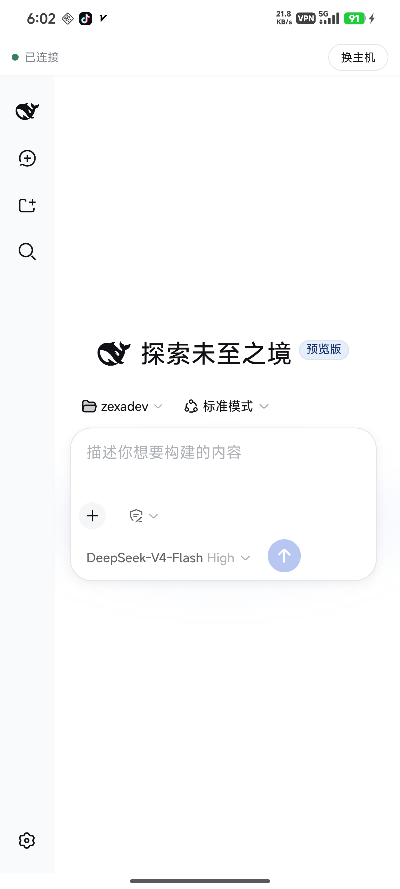
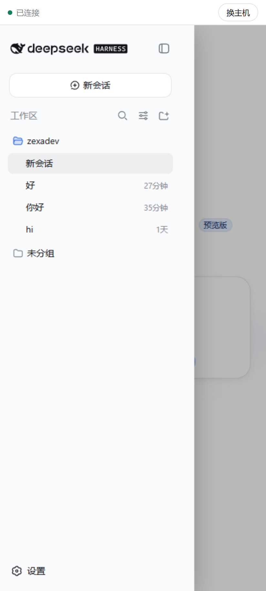
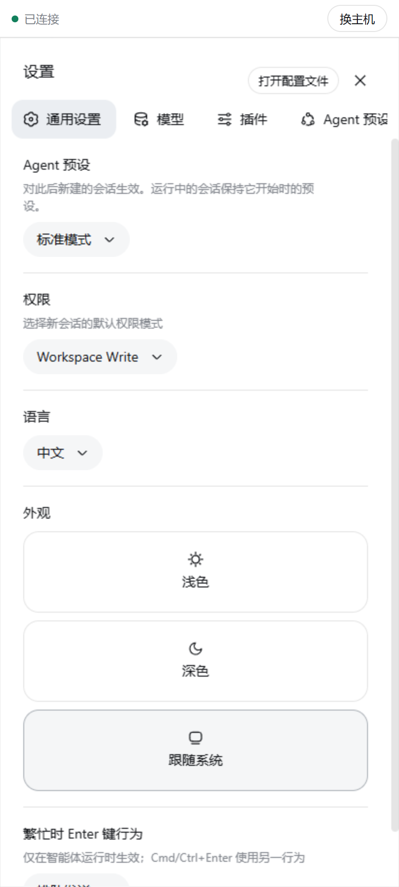

<h1 align="center">DSH Tether</h1>

<p align="center">
  <strong>DSH in your pocket: connect to your machine when you have one, run it on the phone when you don't.</strong><br>
  Remote: across networks, peer to peer, no server to set up, no shared Wi-Fi — if hole-punching fails it falls back to a relay that sees only ciphertext.<br>
  Local (Android): the DeepSeek Harness runs on the phone itself — install and go, no Termux, no commands.
</p>

<p align="center"><sub>An independent community project. Not affiliated with, partnered with, authorised by, or endorsed by DeepSeek.<br>No DeepSeek employee or upstream DeepSeek Harness team member is involved in this repository.<br><a href="README.zh.md">中文</a> · English</sub></p>

<p align="center">
  
</p>

<p align="center">
  <a href="../../releases/latest"></a>
  <a href="../../releases"></a>
  <a href="../../stargazers"></a>
  <a href="LICENSE"></a>
  
  
  
  <a href="https://www.dsh.so/artifact/dsh-tether"></a>
  <a href="https://www.dsh.so/artifact/dsh-tether"></a>
</p>

<p align="center">
  
  
  
</p>

DSH Tether carries the [DeepSeek Harness](https://github.com/deepseek-ai/deepseek-harness) web interface to your phone over a direct peer-to-peer connection. The agent keeps running on the machine your code lives on, and the phone gets DSH's own full interface — conversations, tool calls, approvals and settings, not a reimplementation of them. Pair once with a 6-digit code; after that the two ends find each other whatever network they are on.

When there is no machine around, the same app can run DSH on the phone itself (Android) — see [Local mode](#local-mode-no-machine-needed-android).

## The case it solves

**You are not on your machine's network, and you do not want a server in the middle.**

Reaching your own dev machine from a phone usually asks for one of two things: both ends on the same LAN, or a relay you deploy, configure and trust. This asks for neither. The two ends hole-punch to each other through [iroh](https://www.iroh.computer/), and once they do, nothing passes through a third party; the fallback relay only ever carries ciphertext it cannot read.

If you only use your phone on the same Wi-Fi as your machine, you don't need any of this — a LAN setup is simpler.

### Compared with similar projects

The two projects most often compared with this one are [liguobao/ds-harness-remote](https://github.com/liguobao/ds-harness-remote) and [chokwinlee/deepseek-harness-desktop](https://github.com/chokwinlee/deepseek-harness-desktop). Going by their READMEs:

| | DSH Tether | ds-harness-remote | DSH Desktop |
| --- | --- | --- | --- |
| Connection | Direct first (iroh hole-punching), relay only as fallback and it sees ciphertext only; no account, no server to run | Sign in to its service, then LAN → P2P → TURN → Relay in turn; a self-hosted relay is supported | Same Wi-Fi, or a Tailscale network you set up yourself |
| No machine around | Android local mode: DSH runs on the phone | — | — (its README states it runs no agent on the phone) |
| Clients | Android; iOS beta (an unsigned IPA you sign yourself) | PC, Android, Web; no native iOS app | Desktop, Android, and iPhone through a public TestFlight beta |
| License | MIT | No license file in the repository | MIT |

## Download and install

| Where | Download | How |
| --- | --- | --- |
| Machine | — | `dsh plugin --profile web add dsh-plugin-tether` |
| Phone | `dsh-tether-<version>-arm64.apk` from the [Release](../../releases/latest) | Signed — install it directly; local mode included |
| Phone (iOS) | `dsh-tether-<version>-ios-unsigned.ipa` from the [Release](../../releases/latest) | **Beta**, unsigned — sign it yourself |

The plugin carries a small Rust sidecar that owns the iroh connection, shipped as one package per platform; installing pulls only the one matching your system, with nothing to choose.

The phone build is split by CPU architecture. **Any Android phone from the last decade takes `arm64`**; `arm` is for 32-bit legacy devices, and `x86` / `x86_64` are for emulators and ChromeOS. Picking the wrong one simply gets refused at install time. Only the `arm64` build carries the local-mode runtime; the other three have no such entry.

The iOS build is **beta**: this project has no Mac, so the package is only ever built in CI and has never run on a real device. You sign it yourself with AltStore, Sideloadly or similar (a free Apple ID expires after 7 days). Please open an issue if you hit anything.

You can also build the sidecar from source (needs Rust):

```sh
git clone https://github.com/zexadev/dsh-tether && cd dsh-tether
cargo build --release -p tether-host
dsh plugin --profile web add .
```

## Pair

Start `dsh web` as you normally would, then click **Connect phone** at the bottom of the sidebar. You get one line to copy:

On the phone, open DSH Tether → **Add computer** → paste that whole line → name the computer → connect.

From then on the app connects by itself when you open it.

## Local mode: no machine needed (Android)

Open the app → **Hosts** in the top bar → **Run on this phone**. The first start unpacks the runtime first (about 9 seconds measured); after that the DSH interface appears in about 2 seconds. Enter an API key in Settings and start talking.

- **Install and go**: no Termux, no terminal, no commands, no root. Node 24 and the full dependency tree of dsh `0.2.1-rc.2` ship inside the APK and unpack offline on first start; after that only model API calls need the network.
- **No pairing**: dsh is on this phone, there is no remote end. Sessions, settings and workspaces live only on the phone and are entirely separate from what you see when connected to a machine; switching back and forth touches neither.
- **Stays up**: while running there is a persistent notification (a foreground service), so backgrounding or locking the screen does not get the process reclaimed. If the process is killed anyway, the next launch restarts it; sessions are already on disk.
- **Versioned with the app**: the bundled dsh upgrades with the app; currently `0.2.1-rc.2`.
- Only the `arm64` APK carries local mode; iOS forbids child processes, so the iOS build has no such entry.
- The phone has no bash and no full coreutils, so shell-dependent tools are incomplete; chat and file read/write are unaffected.

The Termux route still works if you prefer it: install dsh and this plugin inside Termux (it picks the `android-arm64` sidecar package automatically), then pair to it in remote mode — the phone is just another "machine". There is no guided setup for that path; it simply keeps working.

## Features

<table>
  <tr>
    <td width="50%" valign="top">
      <h3>Direct across networks</h3>
      <p>The two ends hole-punch to each other through iroh, and once connected nothing passes through a third party. Phone on 4G/5G and machine on home broadband works — no public IP, no tunnel service, no relay of your own. Only a failed hole-punch falls back to a relay, which carries ciphertext it cannot read.</p>
    </td>
    <td width="50%" valign="top">
      <h3>DSH's own interface</h3>
      <p>What runs on your phone is DSH's own web interface, not a reimplementation: conversations, tool calls, approvals and settings are all there. Narrow screens get adjustments — the sidebar becomes an overlay drawer, the settings dialog puts its navigation on top, and content takes the full width.</p>
    </td>
  </tr>
  <tr>
    <td width="50%" valign="top">
      <h3>Several machines</h3>
      <p><em>My computers</em>, at the bottom of the phone's sidebar, keeps every machine you have paired: switch, rename, remove, or add another. Changing machines never means re-entering credentials, and <em>Connect phone</em> on the computer mints a fresh code any time.</p>
    </td>
    <td width="50%" valign="top">
      <h3>Approval notifications</h3>
      <p>When the agent is waiting on your approval, the phone raises a system notification. You approve inside DSH's own interface — this plugin deliberately does not answer approvals for you; it only carries "it's waiting for you" to your lock screen.</p>
    </td>
  </tr>
</table>

## Security

- Pairing is a 6-digit CSPRNG code, valid 10 minutes, 3 attempts per window. After pairing, access is granted by the phone's iroh public key, which iroh's TLS verifies and nobody can forge.
- An unpaired peer cannot reach your interface: proxy streams are only served on a connection that already completed the control-stream handshake, and an unpaired connection may send at most 512 bytes before being rejected.
- Traffic is end-to-end encrypted by iroh (QUIC/TLS). When hole-punching succeeds it touches no third party; when it falls back, the relay only carries ciphertext it cannot read.
- The plugin's own two HTTP routes apply the same browser-trust rules dsh applies to `/api`: the `Host` must be a loopback authority, an explicit cross-site marker is refused, and an attached `Origin` must match the Host. Cross-site requests from a malicious page and DNS-rebinding attempts both get a 403.
- **Known limit**: those rules stop a browser from being used as a confused deputy; they do **not** stop a local process. A local process presents a loopback `Host`, so it can mint a pairing code and pair itself as a "phone" — meaning **an attacker who can already run code on your dev machine can turn that into long-term access**. Don't run this plugin on a machine where you run untrusted code.
- **The phone side has a limit too**: the local proxy the app starts listens on 127.0.0.1 only, but any other app on the phone can connect to it and gets the full dsh interface; the port is derived from the host, so it is easier to find than a random one. Untrusted apps on the phone, or an unlocked phone in someone else's hands, amount to exposing the dev machine.

## Known limitations

- The iOS build is beta: built only in CI, never run on a real device, and you sign it yourself. Android is the one verified on real hardware.
- The app connects when you open it and holds no background connection — Android's doze would not let it anyway.
- The interface on the phone is DSH's own; the narrow-screen fit comes from minimal injected styles, so a dsh layout change may need a follow-up here.
- English and Chinese: the app follows your phone's system language, terminal output follows the computer's, and the part injected into the dsh interface follows dsh's own language setting. There is no separate language switch.
- Local mode exists only in the `arm64` build, never on iOS; the phone lacks bash and a full coreutils, so shell-dependent tools are incomplete. The `arm64` APK is about 83 MB because of the bundled runtime; the others are about 32 MB.
- Verified against dsh **`0.1.0-rc.7`**, **`0.1.0-rc.8`**, **`0.1.2`** (alpha and rc.1), **`0.1.5-alpha.1`**, **`0.1.5-rc.2`**, **`0.1.6-alpha.2`**, **`0.1.7-rc.2`**, **`0.2.0-rc.2`**, **`0.2.1-alpha.1`**, **`0.2.1-alpha.2`**, **`0.2.1-rc.2`**, **`0.2.1-rc.3`**, **`0.2.1-rc.5`** and **`0.2.2-alpha.2`**. dsh is in developer preview — check this line before assuming a newer dsh works. From 0.1.7 dsh refuses to install a plugin whose declared range does not cover it, so a version outside this line is a refusal at install time rather than a silent risk. The browser authentication dsh introduced in 0.1.2-alpha is handled entirely on the machine side; the phone app needs no update for it.

## What has been verified

Direct cross-network connection is the whole point of the project, so here is the evidence rather than the claim. With the phone's Wi-Fi off and only 5G, and the machine on home broadband, the plugin reported a public address on the selected path — meaning the two ends punched through to each other and the relay was never used. The first screenshot above is the phone rendering DSH over that path; note the absent Wi-Fi icon in its status bar.

Pairing (including a wrong code being refused), approval delivery, and switching between saved machines were all verified on a real device. **The relay fallback has not yet been triggered on a real network.**

Local mode was verified on a Redmi running Android 16: a fresh install reaches a working interface in 9.1 seconds (runtime unpacking included) and later starts take 2.1 seconds; the node process survives 30 seconds in the background; force-stopping the app and reopening it restores local mode automatically.

## Relationship to DeepSeek Harness

<p align="center"></p>

DSH Tether is an independent community project built on [DeepSeek Harness](https://github.com/deepseek-ai/deepseek-harness) and its Cordis plugin mechanism. It **does not modify upstream source**: a pinned dsh runs unmodified, and this project joins it as an ordinary DSH plugin using only officially published extension points.

This repository is maintained independently by the community. It is not affiliated with, partnered with, authorised by, or endorsed by DeepSeek, and no DeepSeek employee or upstream team member is involved in its development, maintenance or governance. The DeepSeek Harness mark used in this README identifies the upstream this project serves; it does not imply any authorisation or endorsement. The phone app icon derives from that same upstream mark.

Upstream provides the agent capabilities, the plugin system and the web interface. This project provides:

- the peer-to-peer connection and pairing between machine and phone
- carrying that web interface to the phone, with a narrow-screen fit
- multi-machine management and system notifications on the phone

## Building from source

Needs Node ^22.19 || >=24 and Rust; building the APK also needs JDK 21 and the Android SDK/NDK (`scripts/setup-android-env.ps1` sets that up on Windows).

```sh
cargo build --release -p tether-host          # the machine-side sidecar
cd app && pnpm install
pnpm exec tauri android build --apk --target aarch64
```

## License

MIT

## Links

- [LINUX DO](https://linux.do) — where this project is shared

<p align="center">
  <a href="https://linux.do/"></a>
</p>
