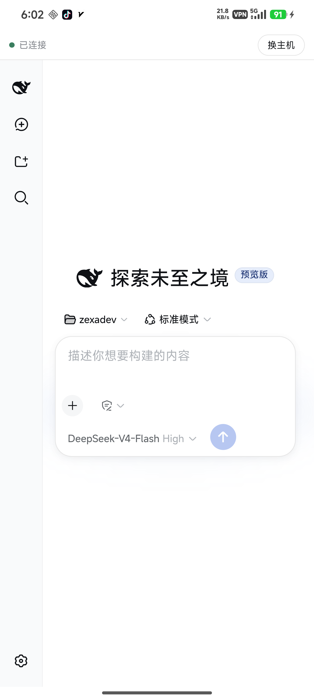
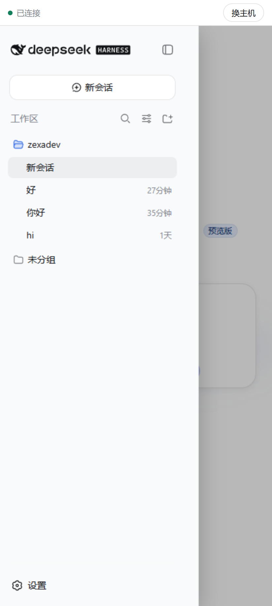
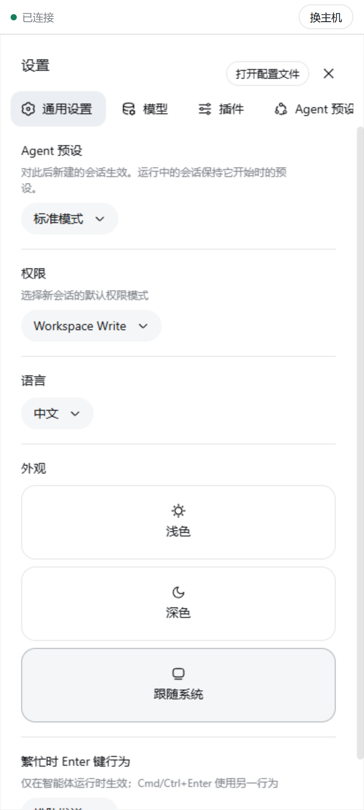

<h1 align="center">DSH Tether</h1>

<p align="center">
  <strong>DSH 随身:有电脑连电脑,没电脑本地跑。</strong><br>
  连电脑:跨网络点对点打洞直连,不用架任何服务器,不用同一个 WiFi;打不通才退回 relay,relay 只见密文。<br>
  本地跑(Android):DeepSeek Harness 直接在手机上运行,装完即用,不装 Termux 不敲命令。
</p>

<p align="center"><sub>独立的社区开源项目,与深度求索不存在隶属、合作、授权或背书关系。<br>本仓库无深度求索员工或 DeepSeek Harness 上游官方团队成员参与。<br>中文 · <a href="README.md">English</a></sub></p>

<p align="center"><sub>官方仓库:<a href="https://github.com/zexadev/dsh-tether">github.com/zexadev/dsh-tether</a>,发版与 issue 都在这里;各 fork 不由本仓维护。<br>DeepSeek Harness (dsh) remote access from your phone: Android / iOS client, peer-to-peer across networks, no server to set up; Android can also run dsh locally.</sub></p>

<p align="center">
  
</p>

<p align="center">
  <a href="../../releases/latest"></a>
  <a href="../../releases"></a>
  <a href="../../stargazers"></a>
  <a href="LICENSE"></a>
  
  
  
  <a href="https://www.dsh.so/artifact/dsh-tether"></a>
  <a href="https://www.dsh.so/artifact/dsh-tether"></a>
</p>

<p align="center">
  
  
  
</p>

DSH Tether 把 [DeepSeek Harness](https://github.com/deepseek-ai/deepseek-harness) 的 Web 界面通过点对点直连带到手机上。agent 依旧跑在你代码所在的那台电脑,手机拿到的是 DSH 自己的完整界面——会话、工具调用、审批、设置全都在,不是另做一套。用 6 位码配对一次,之后两端在哪个网络都能互相找到。

手边没有电脑时,同一个 App 还能在手机本地把 DSH 跑起来(Android),见[本地模式](#本地模式没电脑也能用android)。

## 它解决什么

**你不在电脑那个网络里,又不想中间有一台服务器。**

手机连回自己开发机,常见做法要么要求两端在同一个局域网,要么要求你部署并信任一台中转。这个项目两样都不要:两端靠 [iroh](https://www.iroh.computer/) 直接打洞,打通后流量不经过任何第三方;打不通才退回 relay,而 relay 上过的也只是它读不懂的密文。

如果你只在和电脑同一个 WiFi 下用手机,你并不需要这些——局域网方案更简单。

### 与同类项目的区别

同类里最常被拿来比的是 [liguobao/ds-harness-remote](https://github.com/liguobao/ds-harness-remote) 和 [chokwinlee/deepseek-harness-desktop](https://github.com/chokwinlee/deepseek-harness-desktop)。按各自的 README 对照:

| | DSH Tether | ds-harness-remote | DSH Desktop |
| --- | --- | --- | --- |
| 建链 | 直连优先(iroh 打洞),失败才退回 relay,relay 只见密文;不用账号,不用架服务器 | 登录其服务后建链,LAN → P2P → TURN → Relay 逐级回退,也可自建 relay | 同一 Wi-Fi,或自己搭的 Tailscale |
| 没电脑时 | Android 本地模式,DSH 跑在手机上 | — | —(其 README 明确说不在手机上跑 agent) |
| 客户端 | Android;iOS 测试版(未签名 IPA,需自行签名) | PC、Android、Web,无 iOS 原生 App | 桌面端、Android,以及经公开 TestFlight 的 iPhone 版 |
| 许可证 | MIT | 仓库未附许可证 | MIT |

## 下载与安装

| 装在哪 | 下载 | 安装方式 |
| --- | --- | --- |
| 电脑 | — | `dsh plugin --profile web add dsh-plugin-tether` |
| 手机 | [Release](../../releases/latest) 里的 `dsh-tether-<版本>-arm64.apk` | 已签名,直接安装;内置本地模式 |
| 手机(iOS) | [Release](../../releases/latest) 里的 `dsh-tether-<版本>-ios-unsigned.ipa` | **测试版**,未签名,需自签 |

插件带一个 Rust 写的 sidecar 负责 iroh 连接,按平台拆成独立子包;安装时只会下载与你系统匹配的那一个,不用手动选。

手机端按 CPU 架构分了四个包,**近十年的安卓手机都选 `arm64`**;`arm` 给 32 位老设备,`x86` / `x86_64` 给模拟器和 ChromeOS。装错了系统会直接拒绝安装,不会装出问题。只有 `arm64` 包带本地模式的运行时,其余三个包没有这个入口。

iOS 版是**测试版**:本项目没有 Mac,该包只在 CI 上构建过,从未在真机上运行。需要用 AltStore、Sideloadly 一类工具自行签名(免费 Apple ID 签的应用 7 天过期)。遇到问题请提 issue。

也可以从源码构建 sidecar(需要 Rust):

```sh
git clone https://github.com/zexadev/dsh-tether && cd dsh-tether
cargo build --release -p tether-host
dsh plugin --profile web add .
```

## 配对

电脑上照常启动 `dsh web`,在侧栏底部点**「连接手机」**,会给出一行配对串:

手机上打开 DSH Tether →「添加电脑」→ 把那一整行粘进去 → 给这台电脑起个名字 → 连接。

之后每次打开 App 自动连上,不用再配对。

## 本地模式:没电脑也能用(Android)

打开 App → 顶栏「主机」→ **在本机运行**。第一次要先解压运行时(实测约 9 秒),之后每次约 2 秒出现 dsh 的界面;在设置里填上 API Key 就能对话。

- **装完即用**:不装 Termux、不开终端、不敲命令、不要 root。Node 24 与 dsh `0.2.1-rc.2` 的完整依赖树打在 APK 里,首次启动离线解压;之后只有调用模型 API 才需要网络。
- **没有配对**:dsh 就在这台手机上,没有远端。会话、设置、工作区只存在手机里,和连电脑时看到的完全是两套,来回切换互不影响。
- **常驻**:运行期间有一条常驻通知(前台服务),退后台、锁屏不会被系统收掉;进程真被杀了,下次打开 App 自动重起,会话已落盘不丢。
- **版本随 App 走**:内置的 dsh 随 App 升级一起升,当前内置 `0.2.1-rc.2`。
- 只有 `arm64` 的 APK 带本地模式;iOS 的沙箱不允许子进程,iOS 版没有这个入口。
- 手机上没有 bash 和完整的 coreutils,依赖 shell 的工具用不全;对话、文件读写不受影响。

想走 Termux 的老路也行:在 Termux 里装好 dsh 和本插件(会自动选到 `android-arm64` 的 sidecar 子包),再用远程模式配对连接——手机自己也是一台「电脑」。这条路不做引导,只是仍然能用。

## 主要功能

<table>
  <tr>
    <td width="50%" valign="top">
      <h3>跨网直连</h3>
      <p>两端靠 iroh 直接打洞,打通后流量不经过任何第三方。手机在 4G/5G、电脑在家宽也能连上,不需要公网 IP、内网穿透或自建中转。打洞失败才退回 relay,而 relay 上过的只是它读不懂的密文。</p>
    </td>
    <td width="50%" valign="top">
      <h3>完整的 DSH 界面</h3>
      <p>手机上跑的就是 DSH 自己的 Web 界面,不是另做一套:会话、工具调用、审批、设置一个不少。窄屏下做了适配——侧栏改成抽屉覆盖、设置页导航横排、内容占满整宽。</p>
    </td>
  </tr>
  <tr>
    <td width="50%" valign="top">
      <h3>多台电脑</h3>
      <p>手机侧栏底部的「我的电脑」里,配过的电脑都留着,可以切换、改名、删除,也能添加新的。换一台不用重新填凭证。电脑侧栏的「连接手机」随时能出新的配对码。</p>
    </td>
    <td width="50%" valign="top">
      <h3>审批通知</h3>
      <p>agent 卡在等你批准时,手机会推一条系统通知。批准本身在 DSH 自己的界面里点——本插件刻意不代答审批,只把「它在等你」送到锁屏上。</p>
    </td>
  </tr>
</table>

## 安全

- 配对码是 6 位随机数(CSPRNG),10 分钟有效,每个窗口只许试 3 次。配对之后凭手机的 iroh 公钥授权,那是 TLS 验证过的,伪造不了。
- 未配对方够不到你的界面:代理流只在完成控制流握手的连接上提供,未配对连接首行最多 512 字节就被拒。
- 流量由 iroh 端到端加密(QUIC/TLS)。打洞成功时不经过任何第三方;退回 relay 时,relay 上过的也只是它读不懂的密文。
- 插件自己那两条 HTTP 路由套了与 dsh `/api` 同一套浏览器信任判据:Host 必须是回环权威,跨站标记一律拒,带 Origin 时必须与 Host 同源。恶意网页的跨站请求和 DNS 重绑定都会拿到 403。
- **已知边界**:上面那套判据防的是浏览器被当枪使,**挡不住本机进程**。本机进程的 Host 就是回环,能取到一个配对码,进而把自己配成一台「手机」。也就是说,**已经能在你开发机上执行代码的攻击者,可以借此拿到长期访问权**。若你的机器上会跑不受信任的代码,别用这个插件。
- **手机侧同样有边界**:App 在手机上起的本地代理只监听 127.0.0.1,但手机上其他 App 一样连得上,连上拿到的就是完整 dsh 界面;端口按主机派生固定,比随机端口更容易被找到。手机上装着不受信任的 App,或手机没锁屏落到别人手里,等同于开发机暴露。

## 已知限制

- iOS 版是测试版:只在 CI 上构建,从未在真机运行过,且需要自行签名。安卓版是经过真机验证的那一个。
- App 打开时才连接,不在后台常驻——Android 的 doze 也留不住它。
- 手机上的界面是 DSH 自己的,窄屏适配靠注入的最小样式完成;dsh 改版式时可能需要跟进。
- 中英双语:App 界面跟随手机的系统语言;电脑终端上的输出跟随电脑的系统语言;注入 dsh 界面的那部分跟随 dsh 自己的语言设置。没有单独的语言开关。
- 本地模式只有 `arm64` 包有,iOS 没有;手机上没有 bash 与完整 coreutils,依赖 shell 的工具用不全。arm64 包因内置运行时约 83 MB,其余包约 32 MB。
- 已针对 dsh **`0.1.0-rc.7`**、**`0.1.0-rc.8`**、**`0.1.2`**(alpha 与 rc.1)、**`0.1.5-alpha.1`**、**`0.1.5-rc.2`**、**`0.1.6-alpha.2`**、**`0.1.7-rc.2`**、**`0.2.0-rc.2`**、**`0.2.1-alpha.1`**、**`0.2.1-alpha.2`**、**`0.2.1-rc.2`**、**`0.2.1-rc.3`**、**`0.2.1-rc.5`**、**`0.2.2-alpha.2`** 与 **`0.2.2-rc.1`** 验证。dsh 处于 developer preview,换更新的 dsh 之前先看这一行。0.1.7 起 dsh 会拒绝安装声明范围没覆盖自己的插件,所以这一行之外的版本是装不上,而不是装上了埋雷。dsh 0.1.2-alpha 引入的浏览器认证完全在电脑侧处理,手机 App 无需更新。

## 验证过什么

跨网直连是这个项目的立意,所以给证据而不是给说法。手机关掉 WiFi 只走 5G、电脑在家宽,插件侧输出:

```
[tether] 手机已连接: 我的手机
[tether] 连接路径: P2P 直连(NAT 打洞成功) Ip(…:41341)
```

选中路径是公网地址,说明两端是打洞打通的,relay 全程没用上。上面第一张截图就是手机在这条路径上渲染的 DSH 界面——状态栏没有 WiFi 图标。

配对(含错码被拒)、审批送达、多设备切换都在真机上验证过。**打洞失败退回 relay 这条路径,尚未在真实网络下触发过。**

本地模式在 Redmi(Android 16)真机验证:全新安装后首次启动到界面出现 9.1 秒(含解压运行时),之后启动 2.1 秒;退后台 30 秒 node 进程仍在;强杀 App 后重开自动恢复到本地模式。

## 常见问题

### 需要公网 IP、自己的服务器,或者同一个 WiFi 吗?

都不需要。手机和电脑通过 iroh 互相打洞直连,不注册账号、不部署任何东西;打不通才退回 relay,relay 上过的只是它读不懂的密文。如果你的手机永远和电脑在同一个 WiFi 里,直接走局域网更简单,用不上这个。

### 手机走 4G/5G、电脑在家宽,能连上吗?

能,而且这正是真机验证过的那条路:手机关 WiFi 只走 5G、电脑在家宽,插件侧报出公网直连路径,relay 全程没用上(见[验证过什么](#验证过什么))。打洞失败退回 relay 这条路径本身,尚未在真实网络下触发过。

### 能用自己的 relay 吗?

能,0.1.31 起。默认用的是 iroh 官方(n0)的公共 relay,官方说明它只供开发测试、有速率限制;打洞经常失败的网络(比如手机在运营商级 NAT 后面),或公共 relay 在你那里不稳时,可以换成自己搭的。只改电脑这一侧,手机 App 不用动:电脑发布出去的地址里带的就是你的 relay,手机按地址去连。

1. 在有公网 IP 和域名的服务器上跑 iroh 官方的 relay,版本与本项目锁定的一致,镜像 `n0computer/iroh-relay:v1.0.3`。最小配置(证书走内置的 Let's Encrypt,要开放 80 与 443):

   ```toml
   http_bind_addr = "[::]:80"

   [tls]
   https_bind_addr = "[::]:443"
   hostname = "relay.example.org"
   cert_mode = "LetsEncrypt"
   cert_dir = "/var/lib/iroh-relay/certs"
   contact = "you@example.org"
   ```

2. 在 dsh 的 profile 目录(如 `~/.dsh/profiles/web/`,桌面 App 是 `~/.dsh/profiles/desktop/`)的 `cordis.patch.yml` 末尾加:

   ```yaml
   - id: dsh-tether
     name: dsh-plugin-tether
     config:
       relayUrls:
         - https://relay.example.org
   ```

3. 重启 dsh。终端里会打出 `使用自建 relay: https://relay.example.org/`;地址写错 sidecar 会带原因退出,不会悄悄退回公共 relay。

已知限制:手机仍要靠 iroh 的地址查询服务(`dns.iroh.link`)找到电脑,这一步不经过你的 relay;公共 relay 在手机那边整个不可达时的情况还没验证过。想单独验 relay 这条路,两端都设环境变量 `DSH_TETHER_RELAY_ONLY=1` 可以关掉打洞、只走 relay(仅限电脑端 sidecar 与 `phone-sim`)。

### 有 iOS 版吗?

有,测试版。每个 Release 都带未签名的 ipa,用 AltStore、Sideloadly 一类工具自签安装(免费 Apple ID 签出来的 7 天过期)。它只在 CI 上构建,本项目没有在真机上跑过。本地模式只有 Android 有,iOS 禁止子进程。

### 手边完全没有电脑,能用吗?

Android 可以。`arm64` 包内置了 Node 24 和 dsh `0.2.1-rc.2`,**主机 → 在本机运行**就能在手机上把 DSH 跑起来,不装 Termux、不敲命令、不用 root;arm64 包约 83 MB 就是因为这个。手机上没有 bash 和完整 coreutils,依赖 shell 的工具用不全,对话和读写文件不受影响。

### 能不装 App,用手机网页(H5)或微信小程序访问吗?

不能。App 自己带一个 iroh 端点(自定义 ALPN 的 QUIC),再经手机本地的回环代理把 DSH 界面灌进 WebView;浏览器页面建不起这种连接,小程序的 `<web-view>` 也只能加载白名单里的业务域名。要在浏览器里用,中间必须常驻一台服务器,而这正是本项目要避开的([#11](https://github.com/zexadev/dsh-tether/issues/11))。

### 支持哪些 dsh 版本?

见[已知限制](#已知限制)里那一行,目前是 `0.1.0-rc.7` 到 `0.2.2-rc.1`。dsh 0.1.7 起,声明范围没覆盖到的 dsh 会在安装时直接拒绝,所以不支持的版本是装不上,而不是装上了乱跑。

### 界面停在「正在加载工作区…」,或点「选择工作区」报 `AbortSignal.any is not a function`

0.1.24 已修。华为等厂商随系统发的旧 WebView 还停在 Chromium 114,没有 dsh 0.2.1-rc 前端用到的 `Promise.withResolvers` 和 `AbortSignal.any`;现在 App 在 WebView 缺这两个 API 时自行补上([#20](https://github.com/zexadev/dsh-tether/issues/20))。

### 放一段时间后卡在「重新连接中」不恢复

0.1.24 已修([#19](https://github.com/zexadev/dsh-tether/issues/19)):断链没有上报、手机侧代理端口没有释放。升级到 0.1.24 及以上。

### 和 ds-harness-remote、DSH Desktop 有什么区别?

见[它解决什么](#与同类项目的区别)下面的表。一句话:这里不注册、不架服务器,直连优先、退回时 relay 只见密文,Android 有本地模式,MIT;ds-harness-remote 要登录它的服务,提供 PC / Android / Web;DSH Desktop 要同一个 WiFi 或你自己搭的 Tailscale 网络。

### 这是 DeepSeek 官方项目吗?

不是,是独立的社区项目,见[与 DeepSeek Harness 的关系](#与-deepseek-harness-的关系)。

## 与 DeepSeek Harness 的关系

<p align="center"></p>

DSH Tether 是基于 [DeepSeek Harness](https://github.com/deepseek-ai/deepseek-harness) 与 Cordis 插件机制构建的独立社区项目。它**不修改上游源码**:固定版本的 dsh 原样运行,本项目作为一个普通 DSH 插件接入,只依赖官方公开的扩展点。

本仓库由社区独立维护,与深度求索不存在隶属、合作、授权或背书关系,也无深度求索员工或上游官方团队成员参与开发、维护或治理。README 中使用的 DeepSeek Harness 标识仅用于说明本项目服务于该上游,不代表任何授权或背书关系;手机应用图标同样取自该上游标识。

上游提供智能体能力、插件系统和 Web 界面;本项目负责:

- 电脑与手机之间的点对点连接与配对
- 把上游的 Web 界面带到手机上,并做窄屏适配
- 手机端的多设备管理与系统通知

## 从源码构建

需要 Node ^22.19 || >=24、Rust;构建 APK 另需 JDK 21 与 Android SDK/NDK(Windows 上可用 `scripts/setup-android-env.ps1` 装齐)。

```sh
cargo build --release -p tether-host          # 电脑侧 sidecar
cd app && pnpm install
pnpm exec tauri android build --apk --target aarch64
```

## 许可证

MIT

## 友情链接

- [LINUX DO](https://linux.do) —— 本项目在该社区分享

<p align="center">
  <a href="https://linux.do/"></a>
</p>
